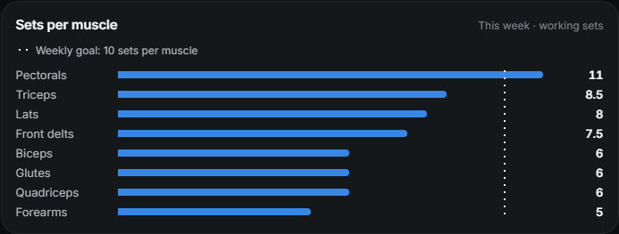
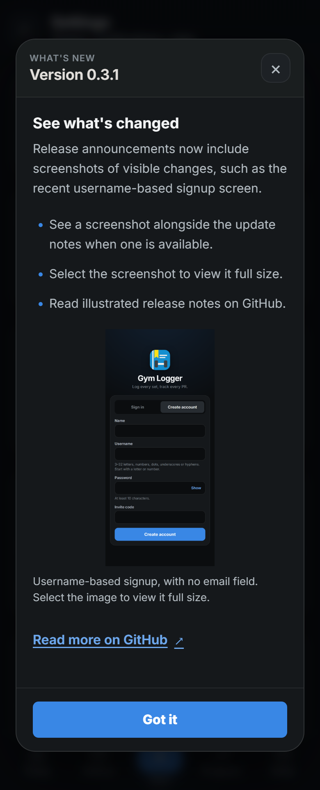
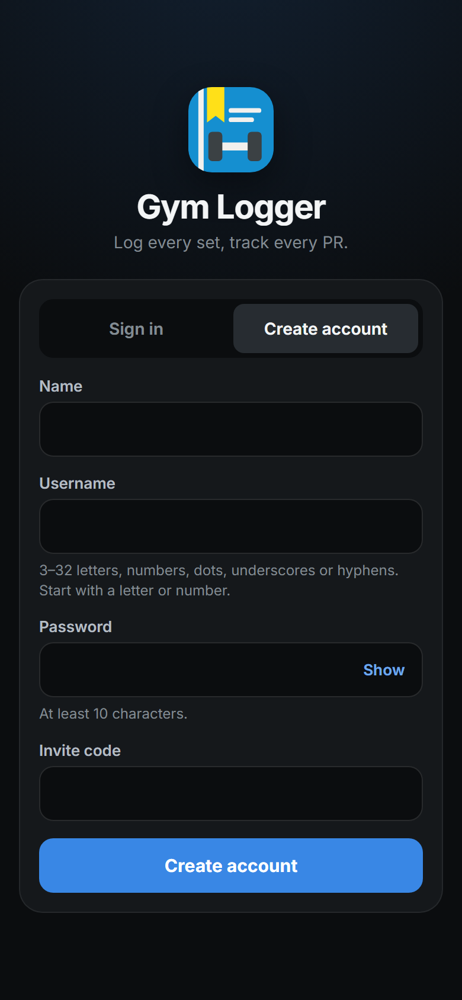

# Gym Logger release notes

## 0.7.0

17 October 2026

### Friends, profiles and a more personal Home

- The weekly muscle-goal line has more space between its dots.
- The [exercise-credit audit](EXERCISE-MUSCLE-CREDITS.md) reviews the built-in library using
  1 set for direct work and 0.5 for meaningful assistance. It aligns row and pulldown
  credits, includes forearm assistance on rows and preacher curls and calf assistance on
  leg curls, refines shoulder press, incline press, deadlift and core credits, and combines
  the old **Upper back** label with **Mid / Upper Back**. Existing workout totals use the
  updated defaults after startup; custom exercises keep their saved mappings.
  **Cable Shoulder Extensions is unchanged and excluded from this audit.** Credits are
  bookkeeping estimates; technique and equipment can change which muscles do most work.

- **Sets per muscle** on Today has a dotted line across the bars for your weekly goal.
  Change **Weekly sets per muscle** in **Settings > Training preferences**. The default is
  **10 working sets per muscle each week**; warmups do not count. The scale keeps the goal
  visible even when all muscle totals are below it.

- History's **Filter by machine** button sits beside **Calendar** in the card header,
  removing the separate row above the calendar.

- Finishing a new or resumed workout returns to **Today** immediately while the saving
  popup sends it to the server in the background. You can browse the app while it saves.
  If saving fails, the workout reopens with your entries intact so you can retry.

- New accounts see the app tour first. The next step offers **Import or export**: it opens
  **Settings > Workout data** with a CSV guide. **Skip for now** shows What's new instead;
  after choosing to import, What's new appears once you leave Settings.
- The three-page CSV guide covers what is imported (and what is not), the columns and
  one-row-per-set layout, and common spreadsheet pitfalls. **Download template CSV** saves
  an example in your weight unit, and **Choose CSV file** opens the file picker. Reopen it
  from the **CSV format guide** link in Workout data, or from the link under a failed import.
- Files you make yourself need only `Date Lifted`, `Exercise` and `Reps` columns, plus
  `Weight (kg)` or `Weight (lb)` for weighted sets. `Warmup`, `Workout ID`, `Workout name`,
  `Bodyweight (kg)`/`Bodyweight (lb)` and `Percentile (%)` remain optional, and exports
  still include every column.
- Column names match regardless of capitalisation and spacing. Semicolon-separated files,
  decimal commas with one or two decimal places (`82,5`), dates followed by a time of day
  and Y/N warmups are accepted. Other columns, such as RPE or notes, are listed in the
  review as not imported rather than rejecting the file.
- Errors are clearer: an unreadable date shows the value found, a non-UTF-8 file explains
  how to save as CSV UTF-8, and a missing header row names the expected columns.
- Pound-to-kilogram conversions are summarised in one warning instead of one per row.
  Import confirmations use singular wording where needed, and the account backup
  instructions link in Workout data opens the technical reference.
- Exports from other apps, such as Strong or Hevy, are not converted automatically; rename
  their columns to the layout shown in the guide first.
- Logging or updating today's body weight shows an **Undo** popup at the top of the
  screen with a five-second countdown bar. Undo removes a new check-in or restores the
  previous weight, body-fat value and notes after an update.
- Daily check-in labels **Body weight** and **Body fat** separately, each with its own
  green **Saved today** summary and no duplicate saved message below the controls.
- The feedback form keeps only **Please leave out passwords and sensitive information.**
  The machine filter's **Clear** button is now labelled **Close**.
- Workout types in the **Consistency** calendar legend now switch on and off. Every type is
  shown at first, each with a tick; tap one to swap its tick for a cross and dim its name.
  The calendar greys out that type's dots, and the borders of days with only hidden types,
  while every date stays readable. Tap the type again to show it.
- Ticking an exercise as finished also ticks its remaining sets, including suggestions from
  your last workout, with the weight and reps shown. A finished exercise no longer reads
  **0 completed working sets**. Blank sets stay unticked, and unticking the exercise leaves
  its logged sets as they are.
- The exercise menu uses clearer icons: a clock for **Recent History** and a link for
  **Group Superset**. **Edit Notes** is removed from the menu; use the note field at the
  bottom of each exercise. **Equipment photo** and **Take photo** show a camera, and the
  **Take photo** button is blue to match the app's accent colour.
- The **Workout live** card on Today has the same spacing below it as the other cards.
- On Home, a card placed beside a taller one centres its content instead of leaving an empty
  gap at the bottom, for example **Sets per muscle** next to **Consistency** or **Daily
  check-in** next to **Recent records**.
- While a workout is live, editing Home no longer shows a placeholder **Next workout** card.
- Mixed compact cards fill an unusable narrow strip at the end of a row. For example, a
  compact **Body weight** card fills the space beside half-width **Consistency**, while
  larger spaces remain available for dropping another section.
- **What's new** shows a date for the current notes and each earlier version, including
  collapsed entries. Older dates are taken from the recorded release-metadata dates.
- In **Edit Home**, drag a section into an empty space beside another card. Expanded cards
  automatically shrink to compact width when dropped into a smaller space. Dotted targets
  highlight spaces that fit the compact card, and its new width stays after saving.
- Empty spaces now show a plus: tap one to choose a section that is not already on Home.
  Only hidden sections appear; when all available sections are added, the picker explains
  that there are none left to add. Sections fit the chosen space, including a third-width
  slot. Dragging into those spaces still works. Tap the top pencil again to **save** the layout; the bottom
  **Cancel** button discards changes. A failed save retains the draft for retry.
- Profile sharing has one button under the three options: **Make my profile private**,
  **Make my profile friends only** or **Make my profile public**, matching your choice. It
  only becomes available when the choice differs from your current setting, and choosing
  your current option again cancels the change. The saved message appears as a
  five-second popup at the top of the screen with a countdown bar.
- A new **Friends** section on Profile replaces the separate shared profiles screen. It
  lists follow requests to approve or decline, who you follow, your followers and a search
  for other members. Tap anyone to open their profile.
- **Search people** replaces the unfiltered Find people list. Search shared accounts by
  display name, username or full account UUID, then open a result or follow/request it.
  Your profile and shared profiles display **Account UUID** with **Copy UUID**. Names match
  without case sensitivity, including accented names. Private and disabled accounts remain
  hidden; friends-only workouts still require approval.
- **Copy UUID** confirms with a popup at the top of the screen that disappears after five
  seconds, with a countdown and dismiss button. Copying again restarts the countdown;
  no message is left beneath the account UUID.
- **Search settings & profile** appears at the top of both pages. Search for rest timers,
  username changes, passwords, sharing, imports and other sections, then tap a result or
  press Enter to jump there. Folded sections open automatically; username/name/photo
  results open profile editing without saving or changing anything.
- **App theme** offers Blue, Emerald, Plum, Coral and Amber accent colours. Choices apply
  immediately and stay on the current device across reloads. Status colours keep their
  meaning.
- **App theme** also offers **Dark** and **Light** modes beside the accent colours. Light
  mode switches every screen, popup, the workout logger and the Add to Home Screen guide to
  light surfaces with darker text, and uses a darker shade of your accent colour so links
  stay readable. Dark remains the default, and the choice stays on the current device.
- The exercise picker's footer labels wrap on narrow screens. **Create super set** is now
  **Add super set**, and the selected exercise count no longer has parentheses.
- The Videos page drops its top **New upload** shortcut. Sets per muscle no longer shows
  **RPE logged on …% of sets**; the untrained-muscle summary remains.
- The compact **Friends** card keeps its list below the heading instead of centring one
  friend in the spare space. It shows the latest workout from up to five followed friends;
  the refreshed sample preview shows multiple people together.
- On Profile, **Profile sharing** and **Friends** start open. **What you share** and
  **Change password** start folded. Tap any heading to open or close
  it; sharing status and waiting request counts remain visible when folded.
- A numbered badge above your profile picture on **Today** shows waiting friend requests.
  It refreshes when you return to Today or refocus the app, including after you handle a request.
- Today's **Friends** card shows the latest workout from up to five friends you follow,
  most recently active first, with workout names, dates, exercises and completed sets.
  Tap a friend to open their profile, or **See all** to manage friends on Profile.
  Move, resize or hide the card with **Edit Home**.
- Profiles label signup dates as **Joined**. **Following since [date]** and **Follows you
  since [date]** show when each relationship began, separately from when someone joined.
  Pending requests are highlighted with a blue dotted outline.
- Profile starts in viewing mode with an **Edit profile** button. Editing reveals the name
  and username fields plus a pencil over a slightly dimmed avatar. Tap it to choose a photo;
  **Remove photo** sits below the avatar on the left. The card keeps its normal border and
  the avatar has no blue outline. Preview or remove the photo, then **Save profile** or
  **Cancel**. Drafts wait for Save.

- **Unfollow** uses the red outline and subtle red tint of the delete-button style.
- Shared profiles have **Filter workouts** controls for workout type, exercise, From/To
  dates and shared machine photos. Filters search the full shared history before pagination,
  including older sessions, and stay applied with **Show more**. Machine filters appear only
  for photos the owner shares. Expand a shared machine photo to filter all workouts on it.
- Daily check-in adds **Body fat** percentage beneath **Body weight**, with its own minus,
  plus and **Log**/**Update** controls. A padded dotted divider separates the rows. Log
  today's weight first; saving body fat preserves that weight and notes. Its five-second
  **Undo** restores body fat without changing the latest weight or notes.

The deployed 0.6.5 announcement is preserved in Earlier versions.

The weekly-goal marker uses small dots spaced eight pixels apart. The
[exercise-credit audit](EXERCISE-MUSCLE-CREDITS.md) lists the direct and assisting credits
for the reviewed library, with Cable Shoulder Extensions explicitly skipped.

The weekly goal uses the same scale as every muscle bar. Captured with synthetic sample
workouts in the isolated verification environment; warmups and unfinished sets are excluded.

Save one weekly working-set goal for every muscle in Training preferences. The default is 10.

The machine filter shares the Calendar heading row. Captured at phone width with sample
workouts in the isolated verification environment.

Today remains usable while a resumed workout saves. This reviewed frame from the isolated
sample-data test recording shows the server request still pending.

The import step after the tour, then pages 2 and 3 of the CSV guide, recorded with a sample
account in the isolated verification environment.

The body-weight Undo popup and single saved-today summary, captured with sample data in
the isolated verification environment.

The Consistency calendar with Upper body and Push switched off, captured with synthetic
sample workouts in the isolated verification environment.

The Friends card moved to the top of a sample dashboard, with one waiting friend request.
Captured with synthetic accounts and workouts in the isolated verification environment.

Viewing mode keeps the avatar clear and shows Edit profile. Sharing is folded here to keep the
highlighted request and relationship dates in view; sharing and Friends still start open.

Editing mode keeps Remove photo on the left and has no blue outline on the card or avatar.
Photo and name drafts wait for Save profile; Cancel discards them.

Copy the account UUID from a profile and share it for an exact lookup, or search by display
name or username. Only shared accounts appear. Captured with synthetic sample accounts;
Profile sharing is folded here to keep the account UUID and search result together.

UUID copying uses the same temporary notification style as other saved actions, on both
your own profile and shared profiles. Captured with a synthetic sample account.

Search across Settings and Profile from either page, and choose a colour for this device.

Light mode selected in App theme, and Today shown in light mode. Captured with a synthetic
sample account in the isolated verification environment.

Multiple sample friends in the compact card, with their latest workouts and completed sets.

Exercise-picker actions wrap at phone width while keeping the selected count visible.

Example of a member viewing someone else's workout with pinned exercise images. The owner
enabled **Machine photos** under **What you share**. These synthetic sample images illustrate
the existing sharing behavior; photos remain hidden when that option is off.

Shared history filters find matching workouts across the member's full shared history. The red
Unfollow button and exact relationship dates remain above the results.

Body weight and body fat have separate controls and saved states. All screenshots use synthetic
sample accounts in the isolated verification environment.

Drag a section into the dotted empty space in Edit Home, then save to keep it beside the existing
card. Expanded sections shrink to fit the smaller space and retain their compact width.

Release-note dates remain visible when a version's changes are folded.

Mixed compact cards fill unusable single-column strips while preserving spaces large enough
for another card. Captured with synthetic sample data in the isolated verification environment.

Tap an empty space's plus to add a missing section in that position. This sample layout
already has every available section except Friends, so only Friends appears.

The chosen card fills the tapped third-width space. The top pencil saves the current layout;
the bottom Cancel action still discards unsaved edits. These examples use synthetic accounts.

## 0.6.5

17 October 2026

### Your videos, your YouTube channel

- Connect your own channel from Settings or Video logger: choose your Google account and
  YouTube channel, approve access, and confirm the channel displayed in the app. Users do
  not need API keys, credential downloads or terminal commands.
- Each account has a separate encrypted connection. Video batches stay tied to their original
  channel; the old shared server token is never used as a fallback.
- Reconnect expired or revoked access and disconnect without deleting videos from YouTube.
  Changing channels and disconnecting are protected while a video is processing.
- New uploads default to YouTube Unlisted. A highlighted explanation says videos are not
  listed on your channel's Videos tab, and anyone with the link can watch and share them.
  Existing server overrides are described accurately; the app's profile-sharing settings do
  not control YouTube access.
- The video toolbar has only New upload. Phone alerts remain in Settings; the separate
  video History and Enable alerts buttons have been removed.
- Existing video links remain. Older unfinished batches without a personal channel binding
  must be started again. Phone uploads still require the app to remain open.
- The video screen leaves room below the final upload action so the bottom navigation does
  not cover it on a phone.
- Administrators configure one Google Web application OAuth client and persistent encryption
  key, then complete Google production consent and a first real-upload check. Migration:
  `0034_youtube_connections`.

The deployed 0.6.0 announcement is preserved in Earlier versions.

A connected sample channel in the isolated verification environment. Google responses were
simulated; the administrator must complete the documented real-channel check after configuring
the installation's Google client.

## 0.6.0

16 October 2026

This release combines PRs #48–#54.

### Faster start with long histories

- Signing in and opening the app load the current month and the two before it,
  rather than every workout ever logged. With seven years of sample training, the
  startup workout download fell from about 21 MB to 0.6 MB and the Today summary
  from about 4.8 s to 0.06 s on the server.
- After a successful sign-in, the form closes from top and bottom, the tagline fades,
  and the Gym Logger logo glides to the centre and fades out. Today is already loading
  underneath, so with a typical phone connection it is ready when the logo leaves.
  What's new and the first-run guides wait until the animation has finished.
  Reduce motion (in Settings or on the phone) replaces this with a short fade.
- Swipe the Today or History calendar back past its oldest month to load the six
  months before it. A card at the edge shows while they load, and the month you
  were viewing stays in place. Both calendars and the History list share what has
  loaded.
- Vertical scrolling in History does not reveal or load more workouts automatically.
  Choose **Show more** to reveal more loaded workouts or fetch the next older six months.
  Horizontal calendar scrolling still loads older months, and the header counts every
  workout logged.
- Whole-history figures are unchanged: streaks, the suggested next workout, export
  time frames and sample-workout removal read the full log. While logging, PR badges
  and previous-set suggestions also compare with a server summary of older sessions.
- The calendar's body-weight lookup no longer rescans every check-in for each
  exercise, which also speeds up apps that have not yet refreshed to this release.

Frames from a recording of the sign-in transition: the form closes, the logo centres,
then Today appears with its data already loaded.

July 2026 loaded when the calendar reached its oldest month. Captures use a separate
database of generated sample training.

Vertical scrolling leaves History at **Show more** until you choose to load more.
Captured with fictional workouts in a separate sample database.

### Find the last time you used a machine

- **History > Workouts** has a **Filter by machine** button. Choose one of your
  saved machine photos to list only the workouts where you pinned that photo,
  newest first. Workouts with the same exercise on other machines are hidden, so a
  machine you last used a year ago is easy to find after many sessions elsewhere.
- The machine list shows each photo's exercise, last-used date, time since then and
  number of workouts. Search appears when you have more than six saved machines.
- The filter summary shows the last-used date, time since then and workout count.
  The most recent session on that machine opens with its exercise highlighted, and
  filtered dates include the year. Use **Change** to pick another machine or
  **Clear** to return to the full History list and calendar.
- In a saved workout, open a pinned photo and choose **All workouts on this
  machine** to filter History by it.
- While logging, each saved equipment photo shows when you last used it, such as
  **Used 1 year ago**, to help you pin the right machine.
- Machine history is loaded from the server, so it includes older workouts that
  History has not loaded yet. Only saved workouts with a pinned photo appear;
  unpinned sessions of the exercise do not.

Filter History by one machine to find your last session there. Captured at phone
width with fictional gyms, photos and workouts in a separate sample database.

Choose from your saved machine photos, ordered by most recent use.

### Easier Home editing

- Tap the Today pencil to edit the cards. The bottom tabs cross-fade into **Cancel**,
  a **green tick** to save, and **Reset layout**, keeping the controls within reach
  as you scroll, and fade back when you finish. Reduce motion makes the swap
  immediate. The old editing box above the cards is removed. Reset previews
  the default layout; tap the tick to keep it or Cancel to keep your saved layout.
- The pencil is highlighted while editing. Tap it again to cancel, just like
  **Cancel**: unsaved changes are discarded and your saved layout stays.
  Tap a card's **X** to hide it. Hidden cards remain available through **Add sections**.
  Hide, resize and drag controls stay circular on compact cards, too.
  The blue **Start** button and green save tick share the same square shape and
  rounded corners, keeping their size consistent as the footer changes modes.

Home layout controls replace the bottom tabs while editing. Captured with a
separate sample account and generated training data.

### Exercise artwork in Progress

- Progress shows the selected exercise illustration beside the latest metric and
  change, above the graph. The illustration updates when you choose another exercise.

The exercise illustration follows the selected exercise. This capture uses generated
sample workouts in an isolated database.

### Earlier releases in What's new

- **What's new** can be compacted. Select **Hide changes** below the summary to
  collapse the change list, screenshot and GitHub link for the current version;
  **Show N changes** expands them again. The title and summary stay visible.
- An **Earlier versions** list follows the current notes. Each previous release
  starts collapsed with its version and title; expand one to read its summary,
  changes, screenshot and GitHub notes. Versions open and close independently, and
  their screenshots load only when expanded.
- **Settings > What's new > View changes** opens the same history at any time.
- The history is bundled with the app from `frontend/release-history.json`, so it
  works offline.

The current notes compacted and one earlier version expanded, captured at phone
width with a fictional account in a separate sample database.

### Aligned Settings update checks

- **Settings > What's new** places **Check for updates** on the right, aligned
  with **View changes** and **Replay guide**.
- Checking for updates shows a timestamped notification for three seconds, with a
  dismiss button and a blue bar along its bottom edge that shrinks from right to
  left as the time runs out, like the personal-record popup. Reduced-motion
  settings show the countdown in one-second steps. Results no longer add persistent
  text or empty space to the Settings card. Available updates still have their
  refresh notification above.

Settings actions share the same right edge, while results appear temporarily above
the page. Captured with an isolated sample account.

No database migration is required for this release.

## 0.5.5

15 October 2026

- A persistent top notification announces a new app release without interrupting
  your current screen. Checks run every minute while the app is visible and online,
  and when you return or reconnect. Use the refresh arrow when ready.
- The current app's cached assets remain available while a replacement service
  worker downloads and waits. App screens no longer reload automatically on updates.
- **Settings > What's new > Check for updates** checks both release information and
  the installed app, with feedback for an available update, the latest version or
  a connection problem.
- Refreshing saves and restores the active workout draft on the same browser and
  device, including exercises, sets, completion and notes. A failed local save blocks
  the refresh; save your workout before updating. Editing a previously saved workout
  also requires saving those edits first. Drafts become server records when the
  workout is finished; clearing browser data removes a local draft.
- The release popup describes the version actually loaded. Once dismissed, it stays
  dismissed for that account and version in this browser, including after logout and
  login. Another device or cleared browser storage can show it again. Settings can
  reopen the notes. Popups wait while logging or uploading and behind other dialogs.
- These update controls apply after loading this release. Older open app versions
  retain their previous update behavior until refreshed. No database migration is required.

The current workout stays usable while an update waits. The next-version label is
a simulated deployment in an isolated sample environment, not an announced release.
Using the arrow restored the completed set, planned set and notes in the new build.

Check manually from Settings. Captures use fictional records and a separate database.

## 0.5.4

15 October 2026

- In **Today > Edit Home**, use the resize button beside a card's drag handle to
  switch between compact and full width. Save widths with the card order and
  visibility across devices. Cancel discards edits; Reset layout restores default
  sizing. Existing layouts keep their automatic sizing until a card is resized.
- The **Daily check-in** weight field is vertically centred with its minus and
  plus buttons. Compact cards move Log/Update below the weight controls.
- Switching away from **Today** cancels layout editing and discards unsaved
  changes. Returning to Today shows the saved layout.
- **Body** history shows an up/down arrow beside each changed weight. For a cut,
  weight loss is green and gain is red; for a bulk, gain is green and loss is red.
  The active goal's start and target weights determine the direction. No active
  goal or a maintenance target uses neutral arrows. Unchanged weights and the
  oldest entry have no arrow.
- Daily entries compare with the previous check-in; weekly and monthly summaries
  compare with the previous period containing check-ins. Comparisons continue
  across pages and use stored kilogram values for either display unit.
- No database migration is required; card widths use existing account settings.

Expand or shrink Home cards without leaving the dashboard. Captured at phone width
from the verified 0.5.4 build with fictional records in a separate sample database.

Arrows show the direction of change, with colours reflecting the active goal.
Both cut and bulk goals were exercised with the isolated sample account.

## 0.5.3

13 October 2026

### User-review corrections before deployment

The [13 October user review](reviews/2026-10-13/USER-REVIEW.md) is preserved for other
agents with [a GitHub tracking index](https://github.com/ejbolts/Gym-video-logger/issues/29).
These corrections remain part of the same pending **0.5.3** release: the public app
still reports **0.3.0**, and this single follow-up PR does not create another release.

- Active workout exercises, completed sets and notes survive reloads. If the exercise
  catalogue is unavailable or incomplete, the original draft is kept and can be retried.
- Inactivity saving leaves untouched previous-session suggestions incomplete. Completed
  sets and values entered by the user retain their existing recovery behavior.
- The selected kilograms/pounds preference applies to weight entry and display across
  workout logging, history, progress, body weight/goals and shared profiles. Storage and
  API values remain in kilograms; CSV labels identify each exported unit.
- Choosing a workout CSV opens a preview. Review sessions, sets, new exercises, warnings
  and duplicates, then save or cancel. Import rechecks the file and current records,
  skips matching sessions and preserves separate same-day sessions in new exports.
  Legacy nine-column files remain accepted and group rows by date.
- Settings explains that workout CSV exports contain set data and omit RPE, rest,
  duration, notes, photos, supersets and goals. It links administrator account-snapshot
  instructions and makes clear that snapshots exclude video files.

The review records historical observations rather than changing their evidence. P2/P3
findings and larger roadmap features remain in the tracking index for future work.

The recovered workout keeps performed and suggested sets distinct and uses the selected
pounds preference. Captured from the verified correction at `5bdac16` on MainPC's private
8447 route with a separate sample database and fictional account.

Review both same-day sessions before saving. Reimporting this file instead shows both
sessions as duplicates and disables Save import. Legacy files warn that their rows are
grouped by date; identical sessions imported separately may be skipped as duplicates.

### Combined release features

This coordinated release includes custom exercise labels (#23), weight and volume records (#24), profile sharing and follow requests (#25), and Home card editing (#26), together with the previously pending guide, feedback and profile-photo improvements. The release is **0.5.3** for the whole batch, as requested; the earlier 0.4.0, 0.4.1 and 0.5.0 proposals were unpublished and are consolidated here.

- Exercises you create show a small **Custom** label under their name in **Select Exercise**, on the exercise card in a workout, and in the **Progress** exercise search. Built-in exercises are unchanged.
- Custom exercises belong to the creator's exercise library. Other accounts cannot find them in their own search, open the creator's personal progress or favorite them, and can still create an exercise with the same name. Exercise names in workouts you choose to share follow your profile-sharing rules.

A sample account's custom Landmine Press in the exercise picker, captured at phone width in the isolated verification environment.

- Choose who can see your profile in **Profile > Profile sharing**: **Private** (only you, the default for every account), **Friends only** (followers you approve) or **Public** (every member who shares). Only members who share their own profile can see or follow others.
- **Follow** a public profile straight away, or **Request to follow** a friends-only one. Requests wait under **Follow requests** in **Shared profiles**, where you **Approve** or **Decline** them; **Profile** shows how many are waiting. **Your followers** lists who follows you, with **Remove**. You can cancel a request or **Unfollow** from someone's profile at any time. Making your profile public approves waiting requests.
- Your **workouts** and **profile photo** are always shared with anyone who can see your profile. A friends-only profile shows only its name and photo until you are approved. Choose separately whether to add **Machine photos** (photos pinned to exercises in your shared workouts), **Body weight** (weigh-ins, body fat and body weight logged with sets), **Goals** (your body-weight goal and weekly Zone 2 target), **Cardio sessions** and **Notes** (including saved video links). While private, choices are a draft until you choose **Share with friends** or **Make my profile public**; afterwards each change saves straight away.
- **Shared profiles** lists you, the people you follow, other public profiles, then friends-only profiles to request, with chips for Public, Friends only, Following, Requested and Follows you. Open a profile to see its totals, shared body-weight trend and goal line, goal progress, recent cardio, and workouts in the weekly History cards: read-only, loaded ten at a time, with shared machine photos that open full size.
- Choosing **Private** hides your profile immediately and hides other profiles until you share again. Followers and choices are kept for when you share again. Usernames, videos and sample data are never shared. Disabled and deleted accounts disappear, and administrators get no extra access.
- Existing installations should run `alembic upgrade head` for migration `0033_profile_sharing` before serving the updated frontend. It adds the `profile_sharing` and `profile_follows` tables only. Sharing choices are included in account backups; follows are relationships with other accounts and are not. Both are deleted with the account. No workout records are changed.

Choose who can see your profile. Workouts and your profile photo are always shared; the rest is optional.

Approve follow requests and follow other members. Friends-only profiles stay locked until their owner approves you.

A shared machine photo inside another member's workout. All captures use fictional sample accounts in the isolated mobile verification environment.

- **Weight PR** means a new heavier completed working set for that exercise. **Volume PR** means more reps in one set at the same previously logged weight for that exercise, including zero added weight. Each exercise and weight has its own baseline; first attempts, ties, lower results and extra total sets do not earn a PR.
- A dismissible **five-second** popup names **Volume PR** or **Weight PR**, the exercise, reps and weight when you complete a record set. A blue bar along its bottom counts down to automatic dismissal and starts fresh for each new record. Existing records do not celebrate again when you reopen, toggle or save an unchanged workout. History, Today and Progress use the same two record types.
- Warmups, incomplete sets, zero reps and failed sets below their configured rep target cannot earn records. Drop sets and failed sets that meet their target remain eligible. Kilogram/pound display preferences do not change comparisons. Backdated workouts, edits and deletions rebuild the derived records in date order.
- Estimated 1RM remains available in Progress, but estimated 1RM, duration and distance increases no longer award PRs. Existing derived PRs are recalculated on backend startup; original workout records are preserved. No database migration is required.
- Progress pairs the heaviest set's weight with that same set's reps and RPE, rather than showing a weight/reps combination from different sets. Estimated 1RM remains the best estimate across eligible sets.

The five-second Volume PR popup with its blue countdown bar and the Custom exercise label in the combined 0.5.3 build. The new 0.5.3 screenshots use fictional accounts and synthetic records on MainPC's isolated 8447 verification route. Earlier guide, sharing-option and machine-photo screenshots are retained from their original feature verification.

The heaviest-set summary now keeps weight and reps from the same logged set. Captured from the combined 0.5.3 build with synthetic workouts.

- Choose the **pencil icon** on **Today** to arrange the actual Home cards directly. Cards gently wiggle like iOS Home Screen icons, with a **drag handle at the top right** and a **minus button at the top left**. Drag a handle with a mouse or touch, or focus it and use the keyboard arrow keys. Minus hides its card; **Add sections** restores hidden cards in their saved positions. This replaces the separate reorder list. It includes the individual weekly stat boxes, next workout, consistency calendar, muscle sets, cardio goal, bodyweight trend, daily check-in and recent records. Card actions are disabled while editing, and both system and in-app reduced-motion settings turn off the wiggle.
- **Save layout** keeps the arrangement in your account across devices and sign-ins. **Cancel** discards edits, and **Reset layout** restores the original order with every section visible before saving. Save failures keep your edits for retry. An active workout's **Resume** card always stays visible even when the next-workout section is hidden. Hiding cards does not delete data or remove the other navigation tabs. Layout preferences use existing account settings and backups; no database migration is required.
- The **History** calendar header no longer shows "Sets per week · swipe for earlier months". Month scrolling and weekly set totals remain available.

Arrange the cards directly while they gently wiggle, and restore hidden cards from Add sections. Captured with an isolated sample account at phone width; the wiggle respects reduced-motion settings.

- New accounts get a feature tour after closing **What's new**. Annotations highlight the real Today, Start, History, Progress, Body and Cardio controls, plus Videos when the account has access. Move with **Next** and **Back**, or **Skip guide** at any time. The tour does not start workouts or uploads.
- Choose **Show steps** after **Make Gym Logger your own** to see the illustrated Home Screen installation page, then **Next** for the thank-you message and optional feedback box. **Back** returns to the feature tour; **Skip guide** remains available. **Send feedback** stores your message privately with your username for administrators to read in **Settings > Admin console > App feedback**. Failed submissions keep your text for retry; retrying the same submission does not create duplicates.
- **Settings > Feedback & feature requests** provides a dedicated form at any time, with **Send another message** after a successful submission. Both this form and the tour explain where messages go: the app's database and private administrator inbox, with your username. Messages are not emailed or posted as GitHub issues.
- **Settings > App guide > Replay guide** starts the tour again. Dismissal is remembered per account/browser, including when using the installed app.
- **Settings > Add to Home Screen > Show steps** opens the illustrated Safari instructions (menu, Share, View More, Add to Home Screen, Add), plus Android Chrome instructions. The illustrations use **gym-logger.duckdns.org** and link to the public app address. This remains available in the installed app to help set up another device.
- Open **Settings** from the top-right button on Today, History, Progress, Body and Cardio, and from the profile, video and admin screens.
- The suggested next workout starts with its explanation and last-session details collapsed. Select the arrow beside the workout title to show or hide them; exercises and Start remain visible.
- The closing screen and Settings link to the GitHub repository and contribution instructions. Contributions use focused branches, sample data, project checks, accessible controls and reviewed UI evidence.
- The tour waits behind release announcements, loading, active workout/upload screens and other dialogs. Older queued installation guides still work; new accounts use the feature tour and can open installation steps from Settings.
- Add a **profile photo** in **Profile**. Choose any JPEG, PNG, WebP, HEIF or HEIC image; Gym Logger rotates it upright and crops it to a square. The photo replaces your initial on the **Today** profile button and in Profile. **Change photo** replaces it and **Remove** goes back to your initial. Photos are private by default and can be shared through Profile sharing. They follow the existing photo upload size limit, are included in account backups and are deleted with the account.
- Release announcements support screenshots that open full size and remain usable when images cannot load.
- **Landscape** on Progress and Body graphs now fills the screen in both native full-screen browsers and the mobile fallback. The Progress expand button remains clickable beside the range controls. Tapping or dragging the rotated graph reads the correct date; the plot resizes when the phone rotates. **Exit** or Escape restores the normal view, and **Open workout** closes the viewer before navigating to the selected session.
- Existing installations should run `alembic upgrade head` for migrations `0031_app_feedback` and `0032_profile_photos` before serving the updated frontend. Feedback is removed when its account is deleted. Profile photo files are stored under `data/profile-photos/`. No account/workout records are changed by these migrations.

The feature tour points to the actual controls. Captured at phone width with isolated sample workouts.

The final screen invites feedback and contributions.

Send ideas from Settings without replaying the tour. The form states who receives messages and where administrators can read them.

After the final feature annotation, **Show steps** opens installation help before the thank-you screen. The public app address appears in the instructions and illustrations.

Workout details start collapsed; the arrow expands them. Settings is available across tabs. All captures use isolated sample records. [Watch the short tour recording](screenshots/releases/0.4.0-app-guide.webm) to see the feature annotations, installation before feedback, a sample feedback submission, the dedicated Settings feedback section and the workout dropdown.

A sample account's profile photo in the isolated mobile verification environment.

The full-screen graph in the combined 0.5.3 build, captured on MainPC's isolated 8447 verification route with synthetic workouts. The portrait fallback presents the same graph rotated for landscape viewing.

## 0.3.1

11 October 2026

- The **What's new** pop-up can show a screenshot alongside the release notes. Select it to view the image full size.
- Screenshots include descriptive text and scale to fit mobile screens. If an image cannot load, the notes, GitHub link and dismissal controls remain available.
- Release screenshots are stored with the GitHub notes; the announcement uses a direct image URL pinned to the screenshot's commit. Releases without a screenshot continue to work.

The illustrated announcement in the isolated mobile verification environment, using the [username signup screenshot](screenshots/releases/0.3.0-username-signup.png) as an example.

## 0.3.0

11 October 2026

- Create accounts and sign in with a **username and password**. Account emails are no longer collected or stored in the active users table.
- Usernames ignore letter case and use 3–32 ASCII letters, numbers, dots, underscores or hyphens, starting with a letter or number. The separate display name remains available.
- Profile, the admin console, account backup metadata and administrative commands now identify accounts by username. CLI commands use `--username` instead of `--email`.
- Existing accounts keep their IDs, passwords, sessions, preferences and workout history. Migration `0030_username_accounts` assigns usernames from the part of the old email before `@`, sanitizes unsupported characters and adds numeric suffixes for collisions. Short or unusable names become `user`. Administrators can run `python -m app.manage list-users` to see assignments.
- Invite codes, registration controls and push notifications continue to work. The server's Web Push contact mailbox is separate from accounts and stays configured.
- New account backup manifests use format 2 with an owner username. Existing backup archives are preserved. Because old account emails are removed, rollback requires the pre-update database backup and previous application version.

Username-based account creation in v0.3.0, captured with empty fields in the isolated verification environment.

## 0.2.0

11 October 2026

- A **What's new** pop-up shows the deployed version, a short list of changes and a link to these GitHub notes when you sign in, reopen the app or reconnect after an update.
- Dismiss a version once per account and browser. Later releases appear automatically; local and production addresses remember dismissal independently. First-time users see the current release too.
- Open **Settings → What's new → View changes** to read the announcement again, including during local development.
- Announcements wait while the workout or video upload screen is open, and while the app is loading or showing a completion/message dialog.

## Publishing the next announcement

1. Edit `frontend/release.json`. Choose the version manually following [the agent release policy](../AGENTS.md#release-versions-and-announcements). Before merging a batch, [evaluate the currently open GitHub PRs](../AGENTS.md#reviewing-and-merging-a-pr-batch), select the included PRs and reconcile their release metadata. A coordinated batch of multiple PRs for an application release gets **one minor bump** (`0.3.0` to `0.4.0`), even if its changes are mostly patches. Every PR in that batch shares the version and contributes to one announcement; do not accumulate its individual version proposals. Reuse an already pending minor release for that batch, consolidate unpublished patch notes into it, and retain the version for follow-up fixes before deployment. For an independently released single PR, default to a patch (`0.3.0` to `0.3.1`); a substantial new capability can justify a minor bump. Documentation/test/tooling-only batches with no application behavior change need no app bump. Compare deployed and pending versions, never reuse a deployed number, and preserve deployed release history. Before replacing a deployed release's notes, move its existing `release.json` object to the top of `frontend/release-history.json` so the app keeps showing it under **Earlier versions**; leave unpublished pending versions out of the history. Update `title`, `summary`, `changes` and `url`. `url` must be an HTTPS GitHub link to your release, changelog or pull request. The build validates the metadata but does not increment versions automatically.
2. Add the detailed notes here (keep previous versions), or publish a GitHub release and link to it instead. If this repository is private, readers need GitHub access to open that link; the short notes remain visible inside the app.
   For a visible feature or UI improvement, include a screenshot of the verified revision using isolated sample data. Inspect it for private information, commit it under `docs/screenshots/releases/` with a versioned filename, and embed it here using a relative image path, descriptive alt text and a caption. Before/after images are useful when they clarify the change. Explain omitted screenshots in the notes or pull request when capture is unavailable or the change has no visible result.
   The optional `image` object in `frontend/release.json` uses `url` and `alt` to display the same screenshot in the app's pop-up. Use a direct HTTPS `raw.githubusercontent.com` image URL pinned to the screenshot's commit, not a GitHub page URL or temporary browser-artifact path. Check anonymous access before publishing; private-repository images may not be accessible to app users. If the image is unavailable, the app still shows the text and dismissal controls.
3. Test the feature and announcement locally. Dismissal is remembered for each version; **View changes** always reopens the dialog without clearing browser data.
4. Commit and push the code and metadata for review. The announcement is included in the frontend build; editing the source metadata alone does not update an existing build.

Vite emits `release.json` into `frontend/dist` with the app and serves it directly during development. The browser checks that deployed file using `cache: no-store`; the service worker does not precache it. The announcement therefore follows the current frontend build. Changing source notes without rebuilding the frontend leaves its announcement unchanged.

If users miss several releases, they see the latest notes and can expand earlier versions in the same pop-up. The build rejects a history entry that is invalid, out of order, duplicated or not older than the current version. Network failures leave the app usable and are retried when it returns to the foreground or reconnects. Dismissal survives sign-out; deleting browser storage shows the notes again. Browsers that block storage remember dismissal for the current page session only.
